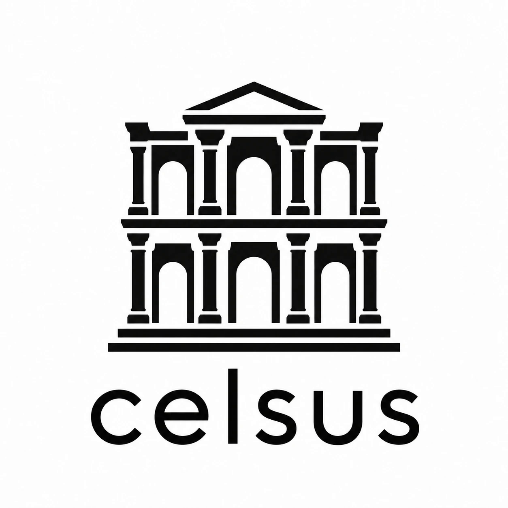
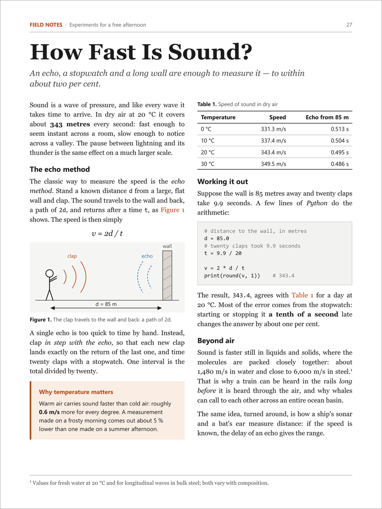
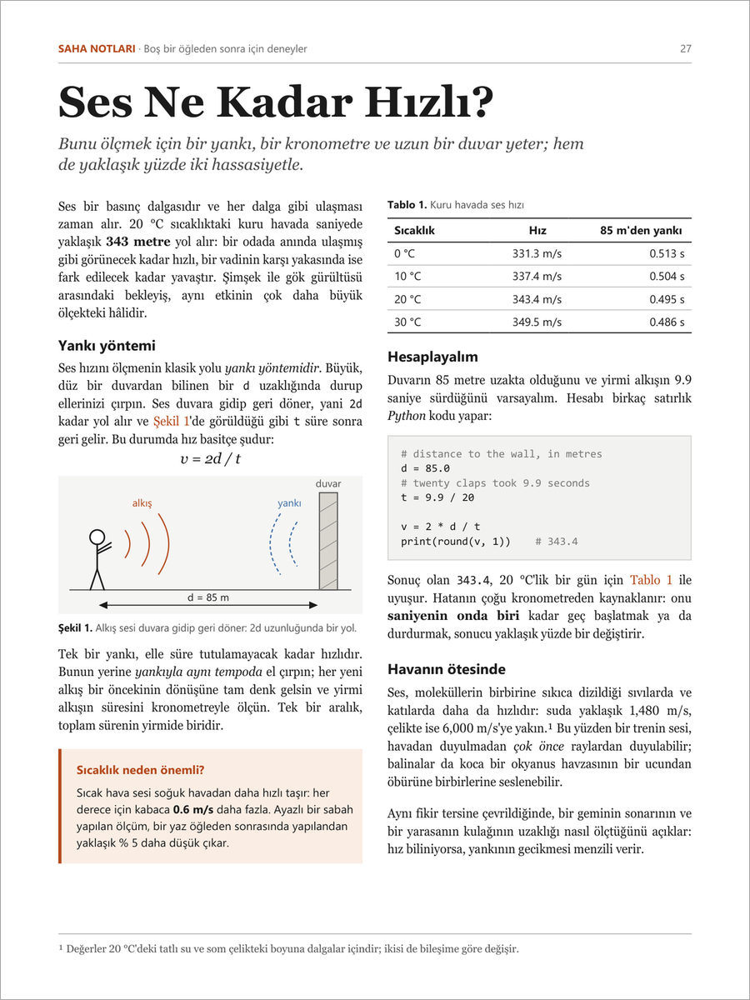
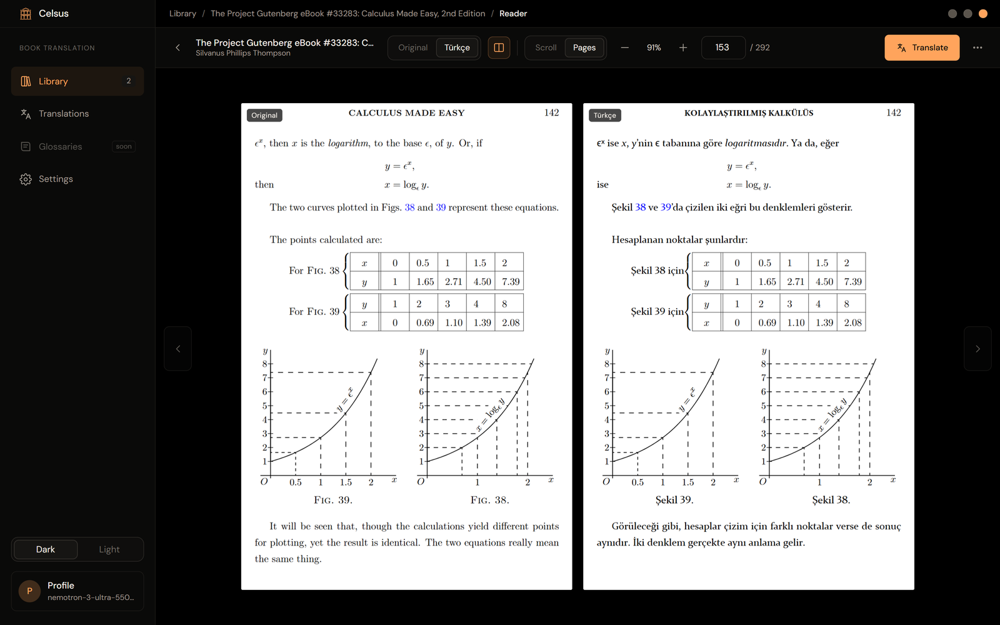

<p align="center">
  <picture>
    <source media="(prefers-color-scheme: dark)" srcset="branding/logo-dark.png">
    
  </picture>
</p>

<p align="center"><b>A library that translates books without breaking their layout.</b></p>

You give Celsus a PDF and a language. It gives you back the same book in that language: every paragraph, heading,
table and caption in the place it was, in a typeface close to the original, with the pictures, code and formulas
untouched.

<p align="center">
  
  
</p>
<p align="center"><sub>Left: a page in English. Right: the same page as Celsus wrote it in Turkish.</sub></p>

It is named after the Library of Celsus in Ephesus.

## Three ways to use it

| | Good when | What you need |
| --- | --- | --- |
| **[Desktop app](#desktop-app-windows-macos-linux)** | you want to translate and read books on your own computer | Windows, macOS or Linux, and a language model (see [what it costs](#questions)) |
| **[From a chat](#translate-from-a-chat-mcp)** | you already pay for Claude, ChatGPT or a coding assistant and want it to do the translating | the desktop app, plus a chat app that supports MCP |
| **[Server](#server-edition)** | a family or a group shares one library, reached from a browser | a home server or Raspberry Pi with Docker |

All three share the same engine and give the same pages.

## How it works

1. **It reads the page.** Celsus finds the blocks of text on each page (paragraphs, headings, list entries, table
   cells, captions, footnotes) and notes where each one stands, its typeface, size and colour.
2. **It sets aside what must not change.** Code, formulas, web addresses and numbers are never sent for
   translation.
3. **A model translates block by block.** Each block goes to the model you chose with a little of the text around
   it. Every answer is checked on your computer: a missing number, a sentence left untranslated, an added comment
   or a list with the wrong number of lines sends the block back with the reason.
4. **It puts the page together again.** All the blocks of a page are placed at once. A translation that is longer
   than the original first takes the room the page has, then tighter lines, then smaller type: never below 70% of
   the original size or 6 pt.
5. **Nothing is cut off.** A block that still does not fit keeps its original text and is listed in the job's
   report, so you know exactly where to look.

## What it keeps

- **The layout.** Columns, tables, tables of contents, running heads, footnotes, page numbers, and text that runs
  around pictures.
- **Styles inside a paragraph.** A word in *italics*, **bold**, a fixed-pitch face or another colour comes back in
  the same style.
- **The look of the type.** For each typeface a book uses, Celsus picks the installed one nearest to it in letter
  widths (the same one when you have it).
- **About 130 languages.** Arabic letters join, Persian, Urdu and Hebrew run right to left, Indian scripts form
  their conjuncts, Thai marks sit in place, and Chinese, Japanese and Korean break between characters. On a page
  of columns written right to left, the columns change places, so the first one is on the right.
- **Covers and pictures.** A picture with text in it, such as a cover, can be redrawn in the target language with
  its artwork, colours and lettering kept.
- **Your work.** Translations are cached. A job that stops halfway picks up where it left off, and translating the
  same text again costs nothing.

It also has a fast built-in reader with a side-by-side view of original and translation, and an interface in
17 languages: English, Türkçe, Deutsch, Français, Español, Italiano, Português, Nederlands, Polski, Русский,
Українська, العربية, हिन्दी, Bahasa Indonesia, 简体中文, 日本語, 한국어.

<p align="center">
  
</p>

## What it does not do yet

- **PDF only.** EPUB and other formats are not read.
- **No scanned books.** A page that is only a photograph of text has no text to read; Celsus does not do OCR.
- **Styles inside a paragraph** are kept for left-to-right languages. A right-to-left translation keeps the style
  of its block.
- **Typeface matching** covers the Latin, Cyrillic and Greek alphabets. Other scripts are written with the system's
  font for that script.
- **No glossary yet.** A list of terms a book must always translate the same way is planned.
- **The installers are not signed**, so your system asks before the first start (see below).

## Get started

### Desktop app (Windows, macOS, Linux)

Download the file for your system from [Releases](https://github.com/byte-me-pls/celsus/releases):

| System | File | Install |
| --- | --- | --- |
| Windows 10, 11 | `Celsus_x.y.z_x64-setup.exe` | Run it. It installs for your user only; no administrator rights are needed. |
| macOS (Apple silicon and Intel) | `Celsus_x.y.z_universal.dmg` | Open it and drag Celsus to Applications. |
| Debian, Ubuntu, Mint | `Celsus_x.y.z_amd64.deb` | `sudo apt install ./Celsus_x.y.z_amd64.deb` |
| Fedora, openSUSE | `Celsus-x.y.z-1.x86_64.rpm` | `sudo dnf install ./Celsus-x.y.z-1.x86_64.rpm` |
| Other Linux | `Celsus_x.y.z_amd64.AppImage` | `chmod +x` it and run it. |

Because the files are not signed yet, the system asks before the first start. On Windows choose *More info → Run
anyway*. On macOS open the app once, then allow it under *System Settings → Privacy & Security → Open Anyway*.
On Linux, translations are written with the Noto, Liberation or DejaVu fonts; most systems have one of them, and
`fonts-noto-core` covers the most languages.

Then, in the app:

1. **Settings → Connections:** add a model connection. The guide on each one tells you where to get a key. Or
   connect a chat app under *Translate from a chat* and skip keys entirely.
2. **Library → Add books:** drop in PDFs. With a model chosen for book details, title, author and subject are
   filled in for you.
3. Open a book, pick the target language and the pages, and press **Add to queue**. Translated pages appear in the
   reader as they finish.

The whole guide: [docs/desktop.md](docs/desktop.md).

The downloads are the last release; the [changelog](CHANGELOG.md) says what is in each one. To try what has
changed on `main` since then, [build from source](#build-from-source).

### Translate from a chat (MCP)

The desktop app can add Celsus to the chat and coding apps it finds on your computer: Claude, OpenAI Codex, Gemini
CLI, Cursor, VS Code and others (**Settings → Connections → Translate from a chat**). After that you ask in plain
words, and the assistant in the chat does the translating with the subscription you already have:

> Translate pages 10–12 of Calculus Made Easy in my Celsus library into Turkish.
>
> Translate the cover of that book into Turkish. Draw it yourself.

Celsus hands out the text block by block, checks every answer and writes the pages. No API key is needed.

On a server, the same tools are at `https://your-server/mcp`: ChatGPT and Claude connect with a sign-in (OAuth),
Codex, Claude Code and Cursor with an API key. The web interface's **Chat apps** page shows how.

Tools, setup by hand and how covers work: [docs/mcp.md](docs/mcp.md).

### Server edition

One shared library for several people, in a browser: accounts, private and shared books, two-step sign-in, API
keys and an audit log, in a Docker image that also runs on a Raspberry Pi.

```sh
curl -fsSL https://raw.githubusercontent.com/byte-me-pls/celsus/main/install.sh | bash
```

Requirements, HTTPS, backups and settings: [docs/server-setup.md](docs/server-setup.md). How it is secured:
[docs/server-security.md](docs/server-security.md).

## Questions

**Does my book leave my computer?**
The PDF file itself never does. What goes out goes only to the model you chose: the text of the blocks being
translated, the opening text of a new book if you let a model fill in its details, and a picture when you ask for
it to be redrawn. With a model that runs on your computer (Ollama, LM Studio) nothing leaves it at all. Celsus has
no telemetry. The desktop app asks GitHub once, when it starts, whether a newer release is out, and downloads
it from there when you press *Update*; those requests carry nothing about you or your books, and *Settings →
General* turns the check off.

**What does it cost?**
Celsus is free. The model may not be. Three ways to pay nothing extra: the free credits NVIDIA gives at
build.nvidia.com, a model running on your own computer, or the chat subscription you already have (over MCP). With
a paid API, the book page shows an estimate in characters and tokens before you start.

**Which model should I use?**
Any model behind an OpenAI-compatible API works: OpenAI, NVIDIA, OpenRouter, Ollama, LM Studio or your own
endpoint. Translation, book details and picture redrawing can each use a different one. A small, fast model is
usually enough for the text.

**Which PDFs work?**
PDFs with real text in them: books from publishers, papers, manuals, anything you can select text in. Scans that
are only pictures do not.

**May I translate any book?**
Celsus is a tool for books you have the right to translate: your own, public-domain ones, or for your own reading
where the law allows it. What you do with a translation is your responsibility.

## Documentation

| Guide | What is in it |
| --- | --- |
| [docs/desktop.md](docs/desktop.md) | Connections and models, translating a book, fonts, covers, the reader, where files are kept |
| [docs/mcp.md](docs/mcp.md) | Translating from a chat: setup for each app, the tools, covers |
| [docs/server-setup.md](docs/server-setup.md) | Installing the server, HTTPS, backups, settings |
| [docs/server-security.md](docs/server-security.md) | What the server protects, against whom, and how |
| [CHANGELOG.md](CHANGELOG.md) | What changed in each release |

## Build from source

You need Rust 1.94 or newer. On Windows the desktop app also needs the WebView2 runtime (included in Windows 10
and 11); on Linux, the WebKitGTK and D-Bus development packages:

```sh
sudo apt install libwebkit2gtk-4.1-dev libgtk-3-dev librsvg2-dev libdbus-1-dev pkg-config patchelf
```

```sh
cargo build --release -p celsus-desktop -p celsus-mcp   # desktop app and MCP server
cargo build --release -p celsus-server                  # server edition
cargo test --workspace                                  # tests (server tests need CELSUS_TEST_DATABASE_URL)
```

The installers are made with the Tauri CLI (`cargo install tauri-cli --version "^2" --locked`), each on the system
it is for: the Windows setup program on Windows, the `.dmg` on macOS, the `.deb`, `.rpm` and AppImage on Linux.

```sh
bash scripts/bundle.sh
```

An installed app updates itself only from files signed with the project's key. With that key in
`TAURI_SIGNING_PRIVATE_KEY` the script also writes a signature beside each installer; without it the installers
are built all the same. A fork that wants its own updates puts its own public key and address under
`plugins.updater` in `crates/celsus-desktop/tauri.conf.json`.

The server image builds with plain `docker build -t celsus .`.

Tests for writing every script use the fonts installed on the system (`C:\Windows\Fonts`,
`/System/Library/Fonts`, `/usr/share/fonts`, or `CELSUS_TEST_FONTS_DIR`); on Linux install `fonts-noto-core` and
`fonts-wqy-zenhei`.

## How it is put together

| Crate | What it does |
| --- | --- |
| `celsus-pdf` | Reads PDFs (objects, streams, fonts, content), and writes changes back with embedded TrueType subsets |
| `celsus-core` | Finds text blocks, talks to models, places and shapes text in every script, writes translated pages |
| `celsus-store` | The desktop library on disk: SQLite, book folders, translation cache, redrawn pictures |
| `celsus-desktop` | The Tauri app and its interface (`ui/`, shared with the web edition) |
| `celsus-mcp` | The MCP server chat apps start to work with the library |
| `celsus-server` | The server edition: HTTP API, accounts and security, PostgreSQL, web interface |

## Licence

Celsus is released under the [MIT licence](LICENSE). It bundles pdf.js (Apache-2.0) and the DM Sans and Instrument
Serif fonts (SIL Open Font License 1.1); their licences are next to them in `crates/celsus-desktop/ui/`.
